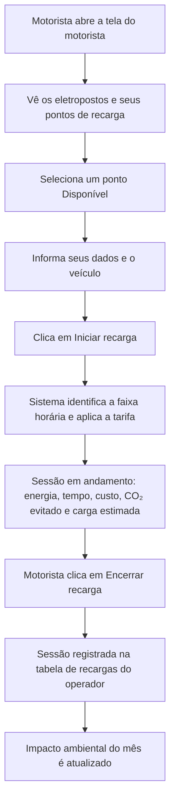

# ChargeGrid Intelligence

Sistema de gestão comercial de eletropostos para veículos elétricos, desenvolvido para o **EV Challenge 2026** (FIAP em parceria com a GoodWe Technologies).

**Sprint 3 – Prototipagem Funcional e Integração**

**Protótipo publicado:** https://chargegrid-ccpw.lovable.app/

- Tela do motorista: `/motorista`
- Dashboard do operador: `/admin`

---

## 1. Título do projeto

**ChargeGrid Intelligence** – tarifa dinâmica por horário, controle de sessões de recarga e métricas de sustentabilidade para eletropostos.

## 2. Equipe envolvida

Equipe 2 – Turma 1CCPW – FIAP

| Nome | RM |
|---|---|
| Henrique Eduardo da Silveira | 571803 |
| Inaldo Pereira Freitas | 569672 |
| Arthur Micarelli Domingos | 571476 |
| Enzo Yudi de Oliveira Hino | 570173 |
| Felipe Elze da Silva | 572024 |

## 3. Sobre o protótipo

O protótipo é uma **aplicação web simulada**. Não há carregador físico conectado: os pontos de recarga, as sessões e os dados exibidos são gerados pelo próprio sistema, o que permite demonstrar o fluxo completo de uma recarga.

A aplicação tem duas telas que trabalham com os mesmos dados:

- **Tela do motorista (`/motorista`):** autoatendimento, sem login complexo. O motorista escolhe um ponto de recarga disponível, informa seus dados e o veículo, inicia a recarga e acompanha energia, tempo, custo, CO₂ evitado e carga estimada da bateria. Também pode encerrar a recarga.
- **Dashboard do operador (`/admin`):** mostra o horário e a tarifa atual, o gráfico de tarifa por hora, a tabela de recargas realizadas, as contas de motoristas cadastradas e o impacto ambiental consolidado do mês.

A rede simulada tem dois eletropostos, cada um com quatro pontos de recarga:

| Eletroposto | Endereço | Pontos |
|---|---|---|
| FIAP Paulista | Av. Paulista, 1106 – Bela Vista, São Paulo | PAU-01 a PAU-04 |
| FIAP Aclimação | Av. Lins de Vasconcelos, 1222 – Aclimação, São Paulo | ACL-01 a ACL-04 |

**Ferramentas:** a aplicação foi desenvolvida com a plataforma **Lovable** (desenvolvimento assistido por IA), a partir dos requisitos definidos pela equipe nas Sprints 1 e 2.

## 4. Esquema de integração dos componentes

### 4.1 Diagrama de blocos


| Bloco | Função |
|---|---|
| Tela do motorista | Escolha do ponto, dados do motorista e do veículo, início, acompanhamento e encerramento da recarga |
| Dashboard do operador | Tarifas por hora, histórico de recargas e impacto ambiental |
| Lógica de gestão | Controle das sessões, tarifa por faixa horária, cálculo de energia e custo e métricas de sustentabilidade |
| Pontos de recarga (simulados) | Oito pontos em dois eletropostos, cada um com seu status |
| Evolução prevista | Carregadores reais GoodWe HCA G2 via OCPP 1.6 e MODBUS RS-485. **Não faz parte do protótipo.** |

### 4.2 Fluxograma de uma sessão de recarga



### 4.3 Imagens do protótipo

**Tela do motorista – escolha do ponto de recarga**


**Tela do motorista – dados do motorista e do veículo**


**Tela do motorista – recarga em andamento**


**Dashboard do operador – tarifas por hora, recargas realizadas e impacto ambiental**


## 5. Justificativa técnica das escolhas

| Escolha | Justificativa |
|---|---|
| Aplicação web publicada em link | Roda em qualquer navegador, sem instalação, o que facilita demonstrar o protótipo e testar a jornada do motorista e do operador. |
| Protótipo simulado | Não há carregador físico disponível. A simulação dos pontos e das sessões permite demonstrar o fluxo completo e gerar dados de recarga. |
| Duas telas (motorista e operador) | Separa quem usa o carregador de quem administra a rede, com os mesmos dados nas duas. |
| Tela do motorista sem login complexo | Reduz o atrito no autoatendimento: o motorista escolhe o ponto, informa o carro e inicia a recarga. |
| Tarifa dinâmica por faixa horária | A estrutura em três faixas (pico, intermediário e fora de pico) se inspira na tarifação horária regulada pela ANEEL e incentiva recarregar fora do horário de pico. |
| Métricas de sustentabilidade | CO₂ evitado, deslocamento limpo equivalente, economia contra combustível fóssil e recargas sustentáveis tornam visível o benefício ambiental da recarga. |
| GoodWe HCA G2, OCPP 1.6 e MODBUS RS-485 | O carregador GoodWe é o equipamento de referência do desafio. OCPP 1.6 (padrão aberto de comunicação entre carregador e sistema de gestão) e MODBUS RS-485 (protocolo industrial para equipamentos de energia) estão previstos para a integração com carregadores reais numa próxima etapa. |

**Tecnologias da aplicação** (conforme `package.json`): TanStack Start e TanStack Router, React 19, TypeScript, Tailwind CSS 4, componentes Radix UI, Recharts e Vite.

### Contribuição para os objetivos do projeto

- **Sustentabilidade:** o dashboard consolida o impacto ambiental (CO₂ evitado, km limpo equivalente, economia contra combustível fóssil e recargas sustentáveis), e a tela do motorista mostra o CO₂ evitado durante a própria recarga.
- **Automação inteligente:** o sistema identifica a faixa horária, aplica a tarifa, calcula energia e custo em tempo real e registra a sessão no histórico sem intervenção do operador.
- **Eficiência energética:** a tarifa mais barata fora do horário de pico incentiva deslocar o consumo para períodos de menor demanda da rede.

## 6. Resultados e dados funcionais

### 6.1 Tarifas por faixa horária (dashboard do operador)

| Faixa | Tarifa | Horários exibidos no gráfico |
|---|---|---|
| Pico | R$ 1,20/kWh | 18h às 20h59 |
| Intermediário | R$ 0,85/kWh | 7h às 17h59 e 21h às 21h59 |
| Fora de pico | R$ 0,55/kWh | 22h às 6h59 |

No teste, às 20h06, o sistema exibiu "Horário de Pico – R$ 1,20/kWh" e marcou a hora atual ("AGORA") no gráfico dentro da faixa de pico.

### 6.2 Sessão de recarga registrada (20/09/2026)

**Durante a recarga** (tela do motorista):

| Ponto | Veículo | Potência | Tempo | Energia | Tarifa | Custo | CO₂ evitado | Carga estimada |
|---|---|---|---|---|---|---|---|---|
| PAU-01 (Paulista) | Tesla Model 3 | 11 kW | 00:00:07 | 0,02 kWh | R$ 1,20/kWh | R$ 0,03 | 0,01 kg | 18% |

**Recarga encerrada** (tabela do dashboard do operador):

| CP | Veículo | kWh | Duração | Tarifa | Custo (R$) | Encerrado em |
|---|---|---|---|---|---|---|
| PAU-01 | Tesla Model 3 | 0,05 | 00:00:16 | Horário de Pico | 0,06 | 20:06:08 |

**Conferência dos cálculos:** energia = potência × tempo, e custo = energia × tarifa.

- Aos 7 s: 11 kW × 7/3600 h = 0,021 kWh, que aparece como 0,02 kWh. Custo: 0,02 × 1,20 = R$ 0,03.
- Aos 16 s: 11 kW × 16/3600 h = 0,049 kWh, que aparece como 0,05 kWh. Custo: 0,05 × 1,20 = R$ 0,06.

### 6.3 Impacto ambiental (consolidado do mês, após a recarga acima)

| Indicador | Valor |
|---|---|
| CO₂ evitado total | 0,02 kg |
| Deslocamento limpo equivalente | 1 km |
| Economia contra combustível fóssil | R$ 0,42 |
| Recargas sustentáveis realizadas | 1 |

A sessão iniciada na tela do motorista aparece no dashboard do operador e atualiza o impacto ambiental, o que demonstra a integração entre as duas telas. A recarga do teste durou poucos segundos apenas para fins de demonstração.

## 7. Conexão com os conteúdos das disciplinas

### Soluções em Energias Renováveis e Sustentáveis

- **Mobilidade elétrica como alternativa ao combustível fóssil:** o sistema quantifica o CO₂ evitado, o deslocamento limpo equivalente e a economia contra combustível fóssil.
- **Grandezas de energia:** potência (kW), energia (kWh) e custo por kWh são calculados e exibidos em tempo real.
- **Gestão da demanda:** a tarifa por faixa horária incentiva o consumo fora do horário de pico.

### Pensamento Computacional e Automação com Python

- **Decomposição:** o problema foi dividido em telas (motorista e operador), pontos de recarga, sessões e tarifas.
- **Abstração:** cada ponto de recarga é representado por um código, um eletroposto e um status; cada sessão, por motorista, veículo, energia, duração, tarifa e custo.
- **Reconhecimento de padrões:** as três faixas de tarifa se repetem a cada dia, e o sistema escolhe a faixa conforme a hora.
- **Algoritmo e automação:** o fluxograma da seção 4.2 descreve o passo a passo da recarga, e o cálculo de energia e custo é feito automaticamente, em tempo real.

A aplicação foi desenvolvida em TypeScript/React, não em Python. A lógica de cálculo é a mesma que se escreveria em Python. Exemplo equivalente, apenas ilustrativo (não faz parte do código da aplicação), que reproduz a conferência da seção 6.2:

```python
def calcular_sessao(potencia_kw, segundos, tarifa_kwh):
    energia_kwh = potencia_kw * segundos / 3600
    custo = energia_kwh * tarifa_kwh
    return energia_kwh, custo

energia, custo = calcular_sessao(11, 16, 1.20)
print(f"{energia:.2f} kWh | R$ {custo:.2f}")  # 0.05 kWh | R$ 0.06
```

## 8. Código-fonte e instruções de funcionamento

### Estrutura do repositório

```
/
├── README.md
├── package.json
├── src/            # código-fonte da aplicação (telas /motorista e /admin)
├── docs/
│   ├── diagramas/  # diagrama de blocos (PNG e SVG)
│   └── prints/     # imagens do protótipo
└── ...             # demais arquivos de configuração do projeto
```

### Como executar localmente

Pré-requisito: **Node.js 22 (LTS) ou superior**.

Baixe o repositório (botão **Code > Download ZIP** ou `git clone`) e, dentro da pasta do projeto, execute:

```bash
npm install
npm run dev
```

Abra no navegador o endereço exibido no terminal e acesse `/motorista` e `/admin`.

Outros comandos disponíveis (`package.json`):

| Comando | Função |
|---|---|
| `npm run build` | Gera a versão de produção |
| `npm run preview` | Visualiza a versão de produção |
| `npm run lint` | Verifica o código com ESLint |
| `npm run format` | Formata o código com Prettier |

### Sem instalar nada

Acesse o protótipo publicado: https://chargegrid-ccpw.lovable.app/
